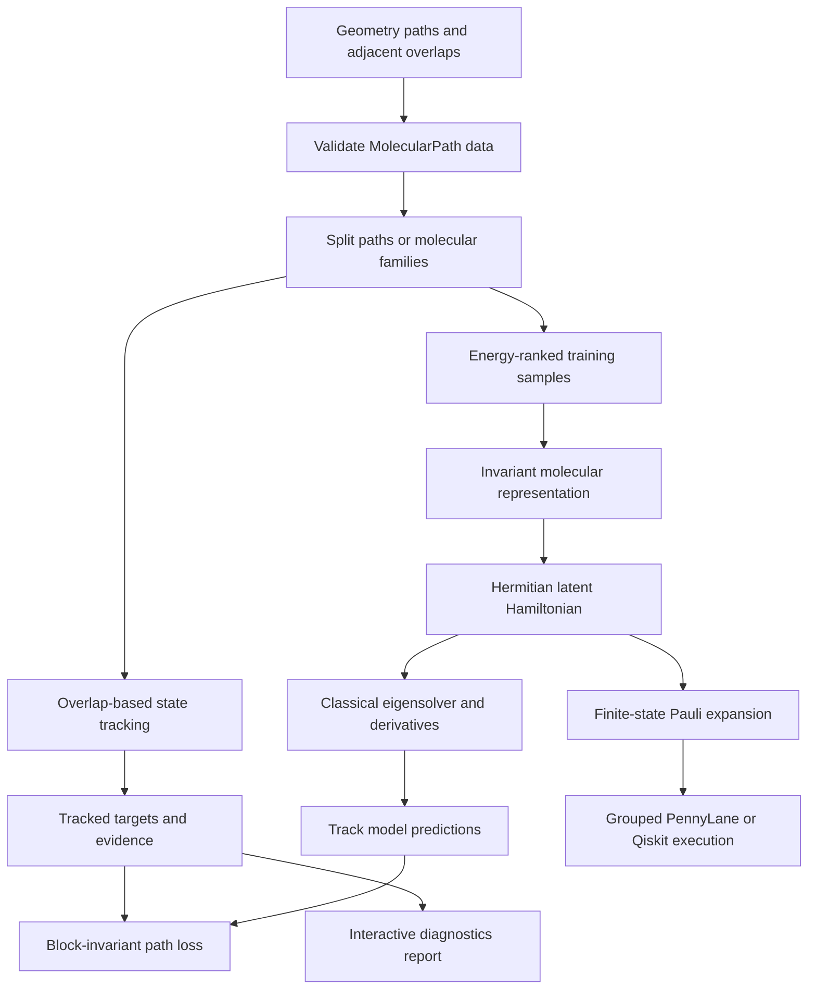

# GeneralDIA

GeneralDIA is a research package for constructing geometry-dependent, finite-state
Hermitian matrices whose eigenvalues and derivatives reproduce selected adiabatic
molecular observables. The model interprets each matrix as a latent diabatic
Hamiltonian.

The package keeps the scientific assumptions visible. You can inspect the molecular
representation, matrix construction, eigendecomposition, Cartesian derivatives, data
adapters, and finite-state qubit encoding without a hidden training framework.

## Scientific question

For atomic numbers $Z$ and nuclear coordinates $R$, GeneralDIA learns

$$
H_\theta(Z,R) \in \mathbb{C}^{N_s\times N_s}.
$$

Diagonalization produces adiabatic energies and states:

$$
H_\theta U = U E, \qquad U^\dagger U=I.
$$

Automatic differentiation then produces energy gradients and the matrix elements

$$
N_{ij}^{A\alpha} =
\left\langle \phi_i \middle|
\frac{\partial H_\theta}{\partial R_{A\alpha}}
\middle| \phi_j \right\rangle.
$$

The training loss can constrain energies, energy gradients, $N_{ij}$, and dipole
operators reported in the same electronic frame. Each target adds information about
the latent matrix.

## Claim boundary

Energy labels constrain the eigenvalues of $H_\theta$. They do not identify a unique
diabatic Hamiltonian. A geometry-dependent unitary transformation can change the
matrix while preserving its spectrum. Physical interpretation requires more
observables, a documented gauge convention, and validation along connected geometry
paths.

GeneralDIA currently provides a compact pair-distance model for method development.
It does not claim the accuracy or scaling of a modern E(3)-equivariant architecture.

## Processing chain



## Installation

Create and activate a virtual environment, then install the editable package:

```bash
python -m venv .venv
```

Windows PowerShell:

```powershell
.venv\Scripts\Activate.ps1
python -m pip install --upgrade pip
python -m pip install -e ".[dev]"
```

Linux or macOS:

```bash
source .venv/bin/activate
python -m pip install --upgrade pip
python -m pip install -e ".[dev]"
```

Verify the installation:

```bash
pytest
```

Optional integrations:

```bash
python -m pip install -e ".[pyscf]"
python -m pip install -e ".[quantum]"
```

## Five-minute example

```python
import torch

from generaldia import SimpleMolecularHamiltonian, derivative_matrix_elements

torch.set_default_dtype(torch.float64)
torch.manual_seed(7)

# Water geometry. Coordinates use angstrom in this example.
atomic_numbers = torch.tensor([8, 1, 1])
positions = torch.tensor(
    [
        [0.00, 0.00, 0.00],
        [0.96, 0.00, 0.00],
        [-0.24, 0.93, 0.00],
    ]
)

model = SimpleMolecularHamiltonian(n_states=2, hidden=32, n_rbf=12)
energies, eigenvectors, numerators = derivative_matrix_elements(model, atomic_numbers, positions)

print(energies.shape)  # (2,)
print(eigenvectors.shape)  # (2, 2), eigenvectors occupy columns
print(numerators.shape)  # (3, 3, 2, 2): atom, Cartesian axis, state, state
```

The untrained model returns numerical values with the claimed symmetry and tensor
shapes. Train it before interpreting those values as molecular predictions.

## End-to-end experiment

Run the synthetic experiment:

```bash
python examples/05_end_to_end_training.py
```

The script performs these operations:

1. Defines a known two-state Hamiltonian along a diatomic bond coordinate.
2. Calculates reference energies and Cartesian gradients from that Hamiltonian.
3. Stores each geometry and its targets in a validated `MolecularSample`.
4. Splits the geometry path into training, validation, and test partitions.
5. Trains `SimpleMolecularHamiltonian` against energies and gradients.
6. Reports held-out mean absolute errors.
7. Saves weights, loss settings, training history, and experiment metadata.
8. Reloads the checkpoint and checks that its predictions match.

The experiment establishes that the software connects data, training, evaluation,
and persistence. It does not establish chemical accuracy because the targets come
from a synthetic Hamiltonian.

## Shared Hamiltonian and dipole operators

The v3.3 development milestone introduced `SharedMolecularOperators`, which
provides real or complex Hermitian Hamiltonians and polar-vector dipoles from one
encoder, with a common tracked electronic frame. Dipole and cross-operator losses
preserve electronic block gauges and spatial rotations. The compact vector head
supports neutral systems and has explicit symmetry/expressivity limits.

```bash
python examples/10_shared_operators.py
python -m pip install -e ".[pyscf]"
python examples/pyscf/03_lih_shared_operators.py
```

The first example exercises complex coupled supervision on an analytic reference.
The second compares identical-initialization Hamiltonian-only, shared energy-only,
and energy/dipole training on physical LiH FCI/STO-3G paths. It is a one-molecule
interpolation experiment, with reference data and checkpoints saved locally.
See [the operator contract](docs/SHARED_OPERATORS.md) and
[the benchmark and validation record](docs/V33_VALIDATION.md).

## Scientific certification (v3.4.0.dev1)

The v3.4.0.dev1 checkpoint added explicit finite-state scientific failure
checks, but is **not** a validated nonadiabatic dynamics method or a completed
molecular conical-intersection benchmark:

- `certify_coupling_numerators` compares automatic derivatives to five-point
  finite differences, optionally checked against an independently supplied
  operator derivative, and rejects unresolved small energy-gap divisions.
- `wilson_loop` evaluates Berry phases and non-Abelian Wilson eigenphases
  from physical cyclic overlaps, including an explicit closing link.
- `certify_state_truncation` diagnoses omitted electronic-state sensitivity
  through principal angles, off-manifold residuals and spectral isolation.
- `FCIDipoleBackend.calculate_loop` computes physical singlet FCI cross-AO
  determinant overlap links, including direct last-to-first closure.
  `certify_abelian_loop_convergence` checks the rank-one Berry phase across
  refined grids; its H2 molecular control must have trivial phase.

```bash
python examples/11_berry_loop.py
python examples/12_coupling_numerator_certification.py
python examples/13_omitted_state_certification.py
python -m pip install -e ".[dev,pyscf]"
python examples/14_physical_fci_loop.py
```

See [topology](docs/V34_TOPOLOGY.md),
[numerator checks](docs/V34_NUMERATORS.md),
[truncation](docs/V34_TRUNCATION.md), and
[molecular loops](docs/V34_MOLECULAR_LOOPS.md). A real polyatomic molecular
conical-intersection reference, state-manifold completeness, and trajectory
certification remain separate scientific gates.

## Charged molecular reference development (v3.4.0.dev2)

The v3.4.0.dev2 checkpoint extended the optional singlet-FCI PySCF reference
adapter with explicit molecular charge. Its H3+ tests check charge/electron
count, orbital overlap and the ionic total-dipole translation law. They do
**not** by themselves establish a molecular conical-intersection Berry phase. See
[charged singlet references](docs/V34_CHARGED_FCI.md) and
[the next physical CI milestone](https://github.com/tmagoben/GeneralDIA/issues/9).

## Numerical reliability hardening (v3.4.0.dev4)

The current development checkpoint strengthens finite-value and state-dimension
checks, preserves complex electronic phases when aligning mixed real/complex
frames, and rejects undefined gauges rather than inventing reference results.
Safe numerical formulas use `hypot` for analytic two-state eigenvalues and
scale positive dataset split weights before normalization to avoid intermediate
overflow. Model-training seeds are explicitly bounded and normalized for both
NumPy and PyTorch. The molecular H3+ CI benchmark and its physical checks are
retained without weaker tolerances.

See [numerical failure and fallback policy](docs/NUMERICAL_FAILURE_POLICY.md)
and [coverage policy](docs/COVERAGE_POLICY.md). The full PySCF suite has a
separate mandatory coverage gate from the dependency-light core suite.

## Physical H3+ conical-intersection benchmark (v3.4.0.dev3)

The current branch computes **actual molecular** FCI wavefunctions around the
symmetry-required degeneracy of H3+'s first two excited singlet states. It
checks two-coordinate branching, state isolation, physical cross-AO cyclic
overlaps, enclosing pi Berry phases, nonenclosing zero phase, reverse
orientation, complex gauge covariance and mesh refinement. GitHub Actions
runs the real PySCF calculation and archives its pass/fail JSON evidence.

```bash
python -m pip install -e ".[dev,pyscf]"
pytest tests/test_h3plus_geometry.py tests/test_h3plus_ci.py -q
python examples/15_h3plus_molecular_ci.py
```

Read [the physical H3+ CI certificate](docs/V34_H3PLUS_CI.md) for the
scientific controls and limitations. This does not certify molecular
derivative couplings, SOC, or nonadiabatic nuclear trajectories.

## Path-aware visual diagnostics

The merged v3.2 milestone supplies invariant path supervision and family-level
leakage checks after a separately committed prior-version audit. Run the training
and incorrect-continuation controls with:

```bash
python examples/09_invariant_path_training.py
```

The example stores settings, split membership, invariant losses, and a checkpoint in
`outputs/invariant_path_training/`. See [the loss contract](docs/PATH_INVARIANT_LOSS.md)
for its mathematical assumptions and [the audit](docs/AUDIT_2026_09_19.md) for fixes.

Connected scans and trajectories can be stored as `MolecularPath` objects and split
as complete units with `MolecularPathDataset`. State tracking then transforms every
state-indexed target with the same permutation, phase, or subspace rotation used for
the electronic frame.

Run:

```bash
python examples/08_path_aware_diagnostics.py
```

The example checks that no path identifier leaks across train, validation, and test
partitions, tracks a phase-scrambled two-state crossing, and writes a self-contained
interactive report to `outputs/path_tracking_report.html`. The report compares raw
energy rank with tracked state character and exposes the overlap evidence and
thresholds behind every transition.

## Documentation map

- [Getting started](docs/GETTING_STARTED.md): installation and command-by-command checks.
- [End-to-end training](docs/TRAINING_WORKFLOW.md): data, losses, fitting, evaluation, and checkpoints.
- [Data and units](docs/DATA_AND_UNITS.md): tensor shapes and PySCF conversions.
- [Scientific scope](docs/SCIENTIFIC_SCOPE.md): supported conclusions and identifiability limits.
- [Architecture](docs/ARCHITECTURE.md): module boundaries and replacement points.
- [Mathematical conventions](docs/CONVENTIONS.md): eigenvectors, derivative elements, NACs, and Pauli labels.
- [Gauge and state tracking](docs/GAUGE_AND_STATE_TRACKING.md): connected-path overlap
  assignment, degenerate subspaces, covariance, and ambiguity diagnostics.
- [Path-aware workflow](docs/PATH_AWARE_WORKFLOW.md): leakage-resistant splits,
  covariant target construction, and visual evidence reports.
- [Invariant path loss](docs/PATH_INVARIANT_LOSS.md): block invariants, derivatives,
  complete-path training, family boundaries, and reproducible controls.
- [Shared operators](docs/SHARED_OPERATORS.md): Hamiltonian/vector dipole models,
  common gauges, coupled losses, molecular references, and expressivity limits.
- [v3.3 validation](docs/V33_VALIDATION.md): checks and held-out LiH comparisons.
- [v3.4 certification](docs/V34_MOLECULAR_LOOPS.md): physical FCI loop closure,
  analytic topology, coupling numerators, truncation, and phase refinement.
- [Development roadmap](docs/ROADMAP.md): release gates from path-aware supervision
  through learned-Hamiltonian quantum benchmarks.
- [Quantum encoding](docs/QUANTUM_ENCODING.md): finite-state encoding and its scaling.
- [Reproducibility](docs/REPRODUCIBILITY.md): records required for a repeatable experiment.
- [Coverage policy](docs/COVERAGE_POLICY.md): separate core-only and PySCF-installed
  scientific suite measurement, thresholds, source scope and remaining gaps.
- [Numerical failure policy](docs/NUMERICAL_FAILURE_POLICY.md): stable calculations,
  declared fallbacks and fail-closed scientific error handling.
- [Limitations](docs/LIMITATIONS.md): current model and backend constraints.

## Development checks

```bash
ruff check .
ruff format --check .
pytest --cov=generaldia --cov-report=term-missing
python -m build
python examples/06_state_tracking.py
```

GitHub Actions runs the core suite across supported Python versions and one Windows
job. A separate complete PySCF-installed test run enforces the stronger full-science
coverage threshold and archives its XML report; optional quantum integrations
have independent tests. See the [coverage policy](docs/COVERAGE_POLICY.md).

## License

GeneralDIA uses the MIT License. See [LICENSE](LICENSE).
